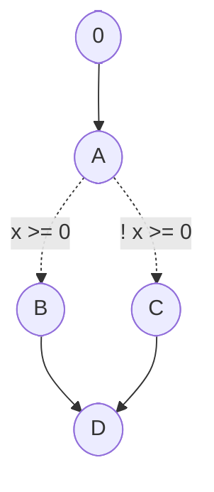

# Méthode "Boite Blanche"

## 1. Structural test or white-box test

À la différences des test en "boite-noire", ici **on connait le code qui est executé**

**Test structurel**
- On considère le test comme une boit blanche car on connait le code
- On connais la structure du programme ce qui nous permet de créer les test lié à celui-ci.
- Le but est alors d'essayer de créer des bugs en partant du code pour voir si tout marche bien.

Le but est alors d'executé le plus de partie du code possible pour voir que toutes les parties du code marche bien.

## 2. Control flow based coverage

En gros on fait un graphe qui sépare les différentes partie du code en fonction des branches possible (`if`, `while`, `for` et aussi `return` car la branche s'arrête plus tôt).

Le but est d'alors à partir du graphe, déterminé les différents tests à effectuer pour avoir un coverage maximal.

Souvent le graphe comment par le noeud `0` qui est le point d'entrée du programme.

> **IMPORTANT** : Pour les boucles `for` il faut bien penser à séparer les 3 partie de la boucle (initialisation ; condition ; incrémentation) dans notre graphe de flow.



*j'ai pas eu le temps de faire un truc bien mais t'as capté*

## 3. Chemin d'execution

Dans notre graphe, une execution de programme correspond alors à un chemin de notre graphe.

Il y a deux type de chemins :
- `POSSIBLE` : Chemin qui peut être executé par notre programme.
- `IMPOSSIBLE`: Chemin qui sera jamais executé par notre programme. Le code associé à ce chemin est alors défini comme "mort".

Il existes des outils qui permet de générer ces graphes de manière automatique.

Ces chemins peuvent être définis apr des expréssion régulière, leurs syntax est la suivante :
- `+` pour un choix
- `.` ou ` ` rien pour la concaténation
- $\epsilon$ lorsqu'un chemin est vide
- `*` lorsqu'il y a une répétition

Par exemple le code `WHILE b DO i` est : `chb(chi chb)*`

Avec `ch` le prefix pour dire que c'est un chemin.


### Prédicats

On peut définir l'execution d'un chemin par rapport à une condition grâce au prédicats.

Par exemple :

$$
P_c(x, y, z) = (x = x_0, y = y_0, z = z_0)
$$

Ici on dit que le chemin `c` est alors exécuté si les pour pour $x, y, z$ respecte les condtion ensuite.


**Exemple** : Prenons cette fonction

```c
int foo (int i)
{
    // Chemin `a`
    i = i + 1;
    i = i * 2;

    if (i < 1)
        i++; // Chemin `b`
    else
        i--; // Chemin `c`

    return i;
}
```

Les la valeur de `i` à la condtion est : 

$$
i_{input} = (i_{input} + 1) \times 2;
$$

Donc ici on peut faire utiliser un prédicat pour modéliser nos deux chemins $a$ et $b$ :

$$
P_{ab}(i) = ((i + 1) \times 2 < 1)
$$

et 

$$
P_{ac}(i) = ((i + 1) \times 2 >= 1)
$$

De cete façon on peut déterminé avec des valeurs mathématique quele chemin peut être executé

## 4. Slelection / coverage criteria

La méthode la plus souvent utiliser est : 

> `path` $\rightarrow$ `path predicate` $\rightarrow$  `input test case`

- D'abord on dit quelle partie du code on veut tester (chemin)
- Ensuite on définit alors quelle sont les conditions pour exécuter cette partie du code (prédicat)
- En fonction de ces conditions alors on déduit les inputs de notre test.

## Critère de coverage

### Path based coverage

On peut calculer le "*coverage*" de notre logiciel à partir de notre control flow graph et de ses chemins.

Le but est de voir quelles est le pourcentage de chemins qui sont empreinter via nos test, le but est que tout les chemins possible soit emprunter par nos test !

$$
Coverage = \frac{C}{N}
$$

Avec $C$ le nombre de chemin qu'on assurer par nos tests et $N$ le nombre de chemin total.

### All-Arcs coverage

On peut aussi calculer le critère de coverage en utilisant les arcs au lieu des chemins ce qui nous donne : `coverage = nb_arcs / total_arcs`.


### Condition Coverage

Même chose mais on se base sur le nombre de condition possible, il faut que toutes les conditions soit au moins une fois à vrai et à false.

Donc pour par exemple le programme

```c
void foo()
{
    int i = 0;

    if ((a == 1) || (b == 1) && ((c == 1) || (d == 1)))
        i += 1;
    else
        i -= 1;
}
```

Il faut juste toutes les conditions une fois à vrai et une fois à false.


Donc

$$
T_1 = 
\begin{pmatrix}
t_1 : < a = 1,\ b = 1,\ c = 1,\ d = 1 \\
t_2 : < a = 0,\ b = 0,\ c = 0,\ d = 0 \\
\end{pmatrix}
$$

Donc en fait c'est pas fou car ça pas vraiment tout les cas possible.

### Decision coverage

Le but est d'ici vraiment pouvoir déterminé toutes les décision possible.

Pour cela on va pour un ensemble de condition déterminé tout les cas possible.

J'ai pas trop compris, mais à chaque fois il faut au moins $N + 1$ alors cas à faire, avec $N$ le nombre de conditions dans notre décision.

Si on prend nombre exemple précedent ça donnerais alors :

$N = 4$, donc il faut au moins $5$ cas.

$$
T_2 = 
\begin{pmatrix}
t_1 : < a = 1,\ b = 0,\ c = 1,\ d = 0 \\
t_2 : < a = 1,\ b = 0,\ c = 0,\ d = 1 \\
t_3 : < a = 0,\ b = 1,\ c = 0,\ d = 1 \\
t_4 : < a = 1,\ b = 0,\ c = 0,\ d = 0 \\
t_5 : < a = 0,\ b = 0,\ c = 0,\ d = 1 \\
\end{pmatrix}
$$

## 5. Tools


